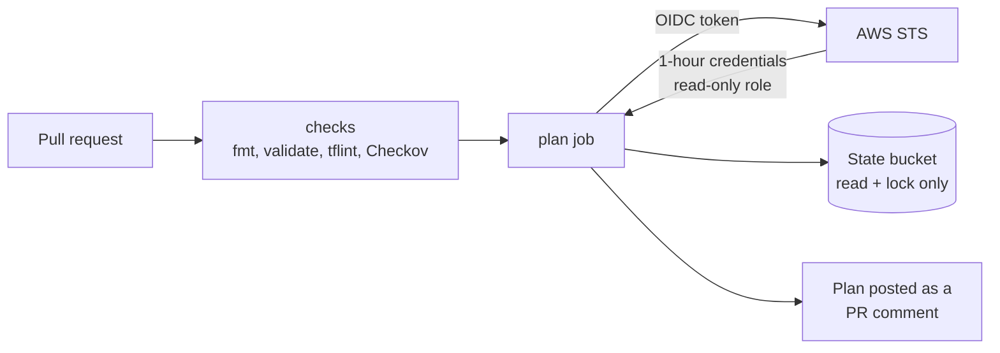

# aws-terraform-pipeline

A secure CI/CD pipeline for Terraform on AWS. GitHub Actions signs in to AWS with OIDC, so there are no stored access keys, and every pull request is formatted, validated, linted, security-scanned and planned before anyone reviews it.

> Work in progress. Session 10 builds the pull request pipeline. Apply with an approval gate, the "break it on purpose" test and the full write-up come next.

## How it works

| Folder | What it is | Who runs it |
|---|---|---|
| `bootstrap/` | GitHub OIDC provider, the read-only plan role, the encrypted state bucket | Me, once, from my laptop |
| `infra/` | Private network baseline: VPC, private subnets in 2 AZs, locked-down default security group, VPC flow logs encrypted with a customer-managed KMS key | The pipeline |
| `.github/workflows/` | The pull request pipeline | GitHub Actions |

## Security choices

- **No long-lived credentials.** The plan role trusts only tokens for pull requests in this repository (`repo:ike-barnes/aws-terraform-pipeline:pull_request`).
- **Plan can't change anything.** The role is read-only, can read state, and can write only the lock file.
- **Actions pinned to commit SHAs**, not tags, because tags can be moved.
- **Least-privilege workflow token**: `contents: read` by default; only the plan job can request an OIDC token or comment.
